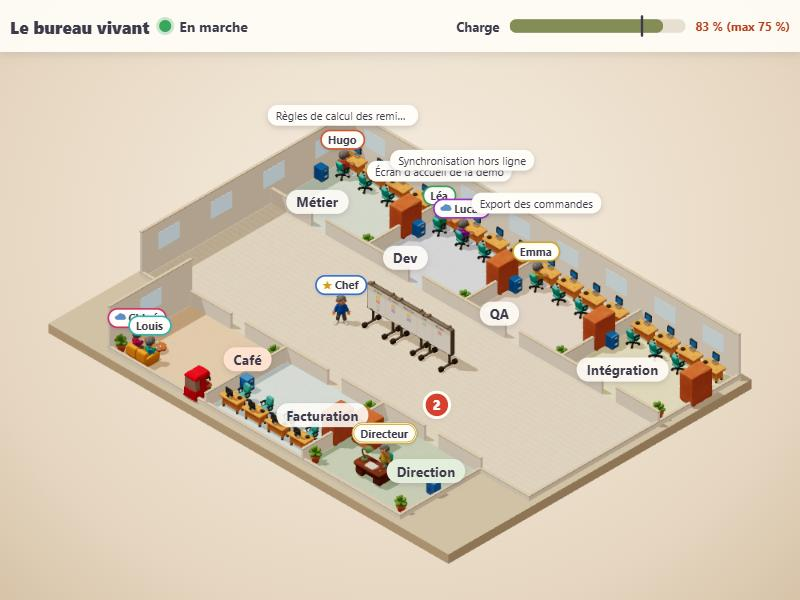
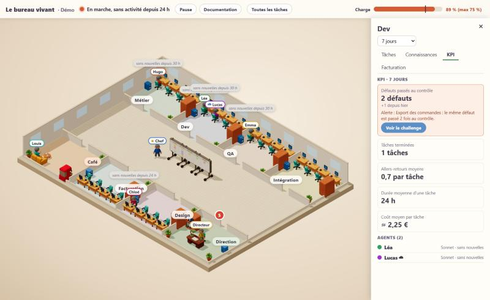
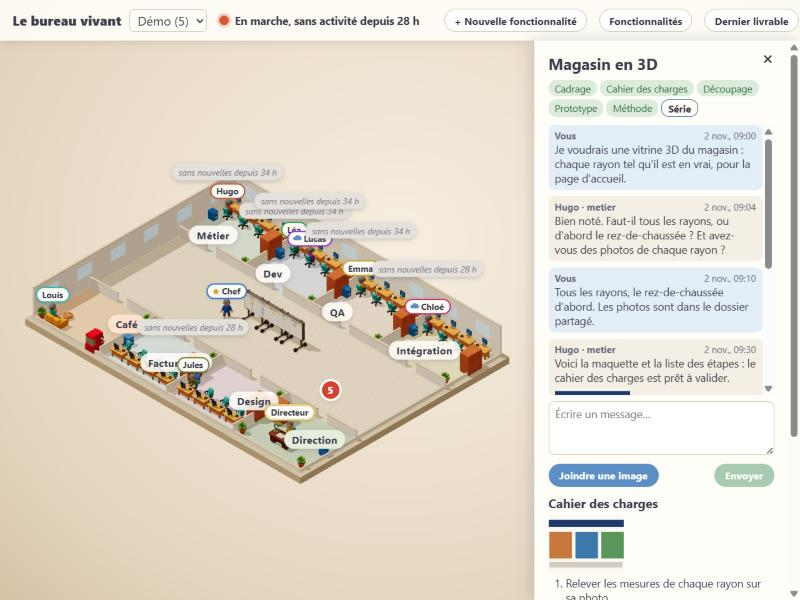
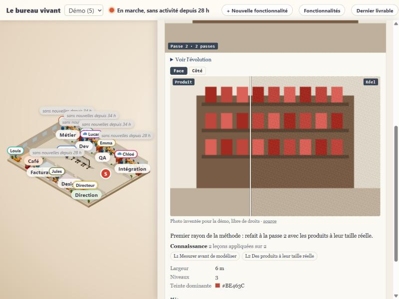

# MyIAFactory

Une skill Claude qui montre une « factory » d'agents IA comme un bureau d'entreprise de jeu vidéo : un open space en 3D isométrique, un bureau par service (Métier, Dev, QA, Intégration, Facturation…), des agents à prénom qui travaillent, vont au café quand ils sont libres, et viennent déplacer leur post-it sur le Kanban central.

Ce dépôt contient la skill **vide de tout projet**. Un projet qui veut son bureau le branche depuis son propre dépôt.

## Comment ça marche

```
le projet ──(relevé : qui tient quelle tâche, dans quelle colonne)──► serveur local du bureau
                                                                        │ ajoute prénoms, statuts, charge de l'ordinateur
                                                                        ▼
                                                              page 3D dans le navigateur
```

- Le projet fournit un **relevé** : un petit document JSON qui dit les faits bruts.
- Le **serveur local** (Python, sans rien à installer) en déduit qui travaille, qui est sans nouvelles, qui est libre, et mesure la charge de l'ordinateur.
- La **page** compare les états successifs et joue les déplacements. Rien n'est simulé.



## Avancement

Projet 1, le bureau vivant :

- [x] 1. Socle et réglages
- [x] 2. Le relevé (contrat entre un projet et le bureau) et l'exemple de démonstration
- [x] 3. Statuts : fraîcheur, pause, départ
- [x] 4. L'équipe : prénoms et couleurs
- [x] 5. L'état servi à la page
- [x] 6. La charge de l'ordinateur et le serveur
- [x] 7. La logique de la page : changements, plan, régie
- [x] 8. La scène 3D en volumes simples
- [x] 9. L'interface : voyant, barre de charge, cartes, panneaux
- [x] 10. Le mode d'emploi
- [x] 11. Le mobilier (modèles Tripo)
- [x] 12. Le personnage (modèle Tripo)

Projet 1 bis, le bureau qui agit ([plan](docs/superpowers/plans/2026-11-10-bureau-qui-agit.md)) :

- [x] 1. Le relevé version 2
- [x] 2. L'état version 2
- [x] 3. Les demandes (du bureau au projet)
- [x] 4. Les images
- [x] 5. Les boutons de la factory et l'envoi des demandes
- [x] 6. Le panneau d'une tâche, la file, la vue liste
- [x] 7. Le Directeur et les leçons
- [x] 8. La démo qui agit, la documentation

Projet 2, les dossiers des services ([plan](docs/superpowers/plans/2026-11-10-dossiers-des-services.md), [passation](docs/superpowers/plans/2026-11-10-dossiers-des-services-passation.md)) :

- [x] 1. Le relevé version 3 et l'usage
- [x] 2. L'historique des usages
- [x] 3. Les prix, mise à jour automatique
- [x] 4. Le calcul des coûts
- [x] 5. Le serveur sert la facturation
- [x] 6. Le dossier, l'onglet Tâches et l'onglet Facturation
- [x] 7. Le relevé et l'état pour les connaissances
- [x] 8. Les trois demandes
- [x] 9. L'onglet Connaissances et le volet « Challenger »
- [x] 10. Les KPI, les alertes, « problème revenu »
- [x] 11. L'onglet KPI
- [x] 12. La démo, la documentation, la relecture (relecture finale faite : voir la passation, phase E)

Projet 3, le parcours d'une tâche ([plan](docs/superpowers/plans/2026-11-10-parcours-d-une-tache.md), [passation](docs/superpowers/plans/2026-11-10-parcours-d-une-tache-passation.md)) :

- [x] 1. Le relevé version 4
- [x] 2. L'état version 4
- [x] 3. Les sept demandes et les images jointes
- [x] 4. Plusieurs projets dans un bureau
- [x] 5. Le catalogue et le dernier livrable servis
- [x] 6. Le sélecteur de projets et la barre
- [x] 7. Le panneau d'une fonctionnalité et sa discussion
- [x] 8. Le Directeur enrichi et la montée de modèle
- [x] 9. Le catalogue d'une fonctionnalité
- [x] 10. Le fichier de factory, l'interface et le suivi générique
- [x] 11. La mémoire à trois étages et les leçons
- [x] 12. Le départ d'un agent, le choix du modèle, le vérificateur d'interface
- [x] 13. Les consignes génériques et le guide de passage
- [x] 14. La démo à deux projets, la documentation, la relecture
- [x] 15. Le vrai passage de bout en bout
- [x] Le passage du projet pilote (phases H à J, dans son dépôt)

Projet 4, l'installation sur un projet ([conception](docs/superpowers/specs/2026-11-11-installation-sur-un-projet-design.md), [plan](docs/superpowers/plans/2026-11-11-installation-sur-un-projet.md), [passation](docs/superpowers/plans/2026-11-11-installation-sur-un-projet-passation.md)) :

- [x] 1. Les chemins `~`
- [x] 2. La limite d'agents locaux
- [x] 3. Une leçon gardée en local quand le push échoue
- [x] 4. Le dossier stable
- [x] 5. L'examen du dossier
- [x] 6. Le calibrage et l'estimation du coût
- [x] 7. La proposition, la mise en place, le bureau commun, la réparation
- [x] 8. La ligne de commande de l'installation
- [x] 9. Le plugin et les consignes de la discussion
- [x] 10. La décision et la commande « organisation »
- [x] 11. Les guides d'accord, relecture finale
- [ ] 12. Le vrai passage sur un projet vide et un projet existant
- [ ] 13. Le projet pilote rejoint le nouveau rangement (dans son dépôt)
- [x] 14. Le support de traitement dans la proposition et la mise en place
- [x] 15. Le bureau ouvert au téléphone, avec un code d'accès
- [x] 16. La vue 3D adaptée au mobile
- [x] 17. Les lots par modèle dans l'orchestrateur

État : le bureau vivant est terminé, le bureau agit (il transmet à un projet les gestes de l'utilisateur et montre le détail des tâches), et chaque service a son dossier : tâches, connaissances partagées entre agents, KPI, coût estimé en euros d'après les tokens, et le geste « Challenger » qui mène d'un problème à une connaissance validée (voir « Les dossiers des services » dans [docs/installation.md](docs/installation.md)). Le projet 3, le parcours d'une tâche, est réalisé dans ce dépôt : un bureau qui suit plusieurs projets, « + Nouvelle fonctionnalité » et la discussion de cadrage, le Directeur enrichi, le catalogue de chaque fonctionnalité, et un **orchestrateur générique** ([consignes](orchestrateur/consignes.md), [interface des commandes](orchestrateur/interface.md), [guide de passage](docs/orchestrateur.md)) avec sa mémoire à trois étages. Le vrai passage de bout en bout est fait (phase G). **Projet 3 terminé, vérifié sur le projet pilote** (voir la [passation](docs/superpowers/plans/2026-11-10-parcours-d-une-tache-passation.md)).







Essayer la démo : `py -3.12 lancer.py serveur --bureau exemples/bureau.json` (deux projets inventés, avec le sélecteur), ou `py -3.12 lancer.py serveur --reglages exemples/demo/reglages.json` (un seul), puis ouvrir `http://127.0.0.1:8770/`. Pour connaître les prix des modèles, le bureau lit deux adresses publiques (une liste de prix et le taux dollar-euro) ; `"prix_automatiques": false` dans les réglages l'en empêche. Les gestes de la démo (Pause, déplacer, retour, verdict, challenge, nouvelle fonctionnalité, discussion, validations, « Demander à modifier ») réécrivent ses fichiers : pour les essayer sans modifier le dépôt, copiez d'abord `exemples/` ailleurs et lancez le bureau sur la copie. Pour démarrer un vrai projet : ajoutez le plugin une fois par machine (`/plugin marketplace add maximus49000/MyIAFactory`, puis `/plugin install myiafactory@myiafactory`), et lancez `/myiafactory:installer` dans une conversation Claude Code ouverte dans le dossier du projet : la commande comprend le projet, propose une organisation chiffrée et configure tout après votre validation, téléphone compris (voir « Installer MyIAFactory sur un projet » et « Le bureau sur le téléphone » dans [docs/installation.md](docs/installation.md)). Passer à la main un projet qui a déjà sa factory : [docs/orchestrateur.md](docs/orchestrateur.md).

Suivre plusieurs projets dans un même bureau : `py -3.12 lancer.py serveur --bureau bureau.local.json`, où `bureau.local.json` vaut `{"port": 8770, "projets": ["<chemin>/.factory/reglages.json", …]}` (de 1 à 12 projets, chemins relatifs à ce fichier ; chaque entrée peut aussi être `{"chemin": …, "id": …}`). Chaque projet garde ses réglages sans changement.

## Ce qu'il reste à faire ensuite

- **Projet 3, le parcours d'une tâche** ([conception](docs/superpowers/specs/2026-11-10-parcours-d-une-tache-design.md)) : le vrai passage de bout en bout avec une conversation orchestratrice (phase G), puis le passage du projet pilote dans son dépôt (phases H à J) : terminé, vérifié sur le projet pilote.
- **Projet 4, l'installation sur un projet** ([conception](docs/superpowers/specs/2026-11-11-installation-sur-un-projet-design.md)) : la réalisation suit la [passation](docs/superpowers/plans/2026-11-11-installation-sur-un-projet-passation.md) ; phases A à E faites (outils de l'installation, plugin et commande `/myiafactory:installer`, organisation qui évolue, lots par modèle, bureau au téléphone et vue mobile) ; phase F faite (guides et relecture finale) ; les essais réels (tâche 12) viennent après la fin de toute l'implémentation, puis la phase G, dans le dépôt du projet pilote.

## Documents

- Conception : [docs/superpowers/specs/2026-11-10-bureau-vivant-design.md](docs/superpowers/specs/2026-11-10-bureau-vivant-design.md) ; le bureau qui agit : [docs/superpowers/specs/2026-11-10-bureau-qui-agit-design.md](docs/superpowers/specs/2026-11-10-bureau-qui-agit-design.md) ; les dossiers des services : [docs/superpowers/specs/2026-11-10-dossiers-des-services-design.md](docs/superpowers/specs/2026-11-10-dossiers-des-services-design.md) ; le parcours d'une tâche : [docs/superpowers/specs/2026-11-10-parcours-d-une-tache-design.md](docs/superpowers/specs/2026-11-10-parcours-d-une-tache-design.md)
- Plan de réalisation : [docs/superpowers/plans/2026-11-10-bureau-vivant.md](docs/superpowers/plans/2026-11-10-bureau-vivant.md)
- L'installation sur un projet : [conception](docs/superpowers/specs/2026-11-11-installation-sur-un-projet-design.md), [plan](docs/superpowers/plans/2026-11-11-installation-sur-un-projet.md), [passation](docs/superpowers/plans/2026-11-11-installation-sur-un-projet-passation.md)
- Plan du parcours d'une tâche : [docs/superpowers/plans/2026-11-10-parcours-d-une-tache.md](docs/superpowers/plans/2026-11-10-parcours-d-une-tache.md), sa passation : [docs/superpowers/plans/2026-11-10-parcours-d-une-tache-passation.md](docs/superpowers/plans/2026-11-10-parcours-d-une-tache-passation.md)
- Passation entre conversations (phases et modèles) : [docs/superpowers/plans/2026-11-10-bureau-vivant-passation.md](docs/superpowers/plans/2026-11-10-bureau-vivant-passation.md)
- Manuel d'installation et de configuration : [docs/installation.md](docs/installation.md)
- Format du relevé : [docs/releve.md](docs/releve.md)
- L'orchestrateur générique : [orchestrateur/consignes.md](orchestrateur/consignes.md), [orchestrateur/interface.md](orchestrateur/interface.md), et le guide de passage d'un projet [docs/orchestrateur.md](docs/orchestrateur.md)
