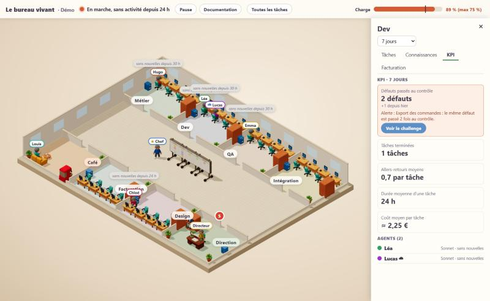

# Installer et configurer le bureau vivant

## Installer MyIAFactory sur un projet

MyIAFactory est un plugin Claude Code. On l'ajoute **une fois par machine**, dans une conversation Claude Code :

```
/plugin marketplace add maximus49000/MyIAFactory
```

```
/plugin install myiafactory@myiafactory
```

Puis, pour chaque projet, ouvrez une conversation Claude Code **dans le dossier du projet** (Sonnet suffit) et lancez :

```
/myiafactory:installer
```

La commande :

1. crée ou met à jour le **dossier stable** `~/MyIAFactory` : une copie de la skill (`~/MyIAFactory/skill`, mise à jour
   par `git pull` aux usages suivants), le fichier de bureau commun (`~/MyIAFactory/bureau.json`), les propositions en
   attente et la clé d'accès du téléphone. Ce chemin ne bouge pas quand le plugin se met à jour ;
2. regarde le dossier : **vide** (une question à la fois : le sujet, le livrable, ce qui serait faux, les outils, la
   première fonctionnalité), **existant** (un sous-agent Haiku lit l'essentiel et en fait un résumé, que vous
   corrigez), **déjà installé** (elle vérifie et répare sans refaire la discussion) ou doté de **sa propre factory**
   (elle renvoie vers [`orchestrateur.md`](orchestrateur.md)) ;
3. pose les questions communes : ordinateur et/ou téléphone, agents cloud ou local seulement, la facturation est-elle
   un objectif, le genre du projet, ses mots interdits, et (projet vide) faut-il un dépôt GitHub privé ; elle mesure
   la machine pour fixer la charge maximum et le nombre d'agents locaux en parallèle ;
4. présente la **proposition** : ce qu'elle a compris, le paramétrage, les services et les agents, le workflow le plus
   court qui tienne (chaque étape justifiée) et une fourchette de coût par élément. Vous corrigez autant de tours que
   nécessaire. **Rien n'est écrit dans le projet avant votre « je valide »** ;
5. met en place : `.factory/` (fichier de factory, réglages, fiches, briefs, consignes propres, contrôles), le
   `.gitignore`, l'inscription au bureau commun, les accès du téléphone demandés, puis la vérification
   (`verifier_interface.py`) ;
6. donne la fin : les sessions cloud à créer (clé, rôle, modèle à régler, environnement), la commande du bureau et le
   message qui ouvre la conversation orchestratrice. Le projet est prêt pour une première fonctionnalité, qui se lance
   depuis le bureau (« + Nouvelle fonctionnalité »).

Le bureau commun suit tous les projets installés sur la machine :

```bash
py -3.12 "$HOME/MyIAFactory/skill/lancer.py" serveur --bureau "$HOME/MyIAFactory/bureau.json"
```

(`$HOME` marche dans PowerShell comme dans bash ; hors Windows, `python3` à la place de `py -3.12`.) Un seul bureau sert
tous les projets : un projet installé pendant qu'il tourne apparaît dans la liste déroulante, sans redémarrage
(seule l'ouverture d'un nouvel accès au téléphone demande de le relancer, ce que l'installation fait elle-même).

Sans le plugin, on peut toujours lancer le bureau à la main depuis une copie de ce dépôt : c'est ce que fait la suite
de ce manuel.

## Ce qu'il faut

- Windows (la mesure de charge de l'ordinateur n'existe que sous Windows ; ailleurs, le bureau fonctionne mais la barre affiche « Mesure indisponible »).
- Python 3.12, lancé par `py -3.12`.
- Un navigateur récent.

Rien d'autre : pas de paquet à installer, ni Python ni npm. three.js est déjà copié dans le dépôt.

## Essayer avec la démo

Depuis la racine du dépôt :

```bash
py -3.12 lancer.py serveur --bureau exemples/bureau.json
```

Le bureau suit alors **deux projets inventés** : « Démo » (une application de gestion, avec une fonctionnalité en
série et son catalogue) et « Démo B » (une fonctionnalité en cadrage). Le sélecteur en haut à gauche passe de l'un à
l'autre (voir « Plusieurs projets »). Pour un seul projet, sans sélecteur, comme avant :

```bash
py -3.12 lancer.py serveur --reglages exemples/demo/reglages.json
```

**La démo joue le projet** : ses commandes d'actions (`exemples/demo/actions.py`, que la démo B réutilise) écrivent
dans `releve.json` et `catalogue-magasin.json`, et rangent les images jointes dans `images/pieces/`. Pour garder le
dépôt propre, copiez le dossier `exemples/` en entier ailleurs et lancez le bureau sur la copie.

Le terminal affiche `Le bureau est ouvert sur http://127.0.0.1:8770/`. Ouvrez cette adresse dans le navigateur (l'adresse `http://localhost:8770/` marche aussi ; aucune autre n'est acceptée).

Ce qu'on doit voir : le bâtiment en 3D isométrique, une pièce par service (Métier, Dev, QA, Intégration, Facturation, Design), le coin café, le bureau du Directeur avec une pastille « 5 » (ce qui l'attend : décisions et leçons), le chef près du Kanban central rempli de post-its, le voyant de la factory et la barre de charge en haut. Survolez un agent pour voir sa carte, cliquez sur une pièce pour ouvrir le dossier du service à droite (voir « Les dossiers des services »), sur un post-it pour le détailler. Échap ferme.

La démo fait deux lectures sur Internet pour connaître les prix des modèles (voir « Les euros : d'où viennent les prix ») ; pour l'essayer sans aucune requête sortante, ajoutez `"prix_automatiques": false` à `exemples/demo/reglages.json` (les coûts s'affichent alors « prix inconnu »).

**Pourquoi les agents de la démo sont « sans nouvelles »** : les dates `maj` du relevé de démonstration sont fixes, donc de plus en plus anciennes. Le bureau ne prétend jamais qu'un agent travaille si rien n'a bougé depuis plus que le délai de fraîcheur (30 minutes par défaut) : ils restent à leur poste, avec une bulle grisée. Pour les voir au travail, ouvrez `exemples/demo/releve.json` et mettez à une tâche active une `maj` récente (par exemple l'heure qu'il est) ; pour voir un déplacement, changez en plus sa `colonne`. Dans les secondes qui suivent, l'agent marche jusqu'au Kanban et déplace son post-it. Passez `factory.etat` à `"en pause"` : le voyant change et la lumière baisse.

Arrêter le bureau : `Ctrl+C` dans le terminal.

## Plusieurs projets

Un **fichier de bureau** liste les réglages de plusieurs projets (12 au plus), chemins relatifs à lui :

```json
{"port": 8770, "projets": [{"chemin": "demo/reglages.json", "id": "demo"}, "demo-b/reglages.json"]}
```

```bash
py -3.12 lancer.py serveur --bureau exemples/bureau.json
```

`id` (facultatif) est l'identifiant du projet dans les adresses (`?projet=…`) ; sans lui, il vient du nom du dossier.
Deux projets ne peuvent pas avoir leurs réglages dans le même dossier. Le nom du projet devient un **sélecteur**, avec
pour chaque projet la pastille de ce qui l'attend ; le choix est retenu par le navigateur, et changer de projet
recharge la page. Chaque geste va à la commande d'actions **du projet choisi**, vérifié contre son relevé ; un projet
aux réglages illisibles n'empêche pas les autres de marcher. La charge est celle de la machine, commune à tous.

## Nouvelle fonctionnalité et discussion

Avec un relevé en version 4 et une commande d'actions, la barre gagne « **+ Nouvelle fonctionnalité** » et
« **Fonctionnalités** ». Le panneau d'une fonctionnalité s'ouvre à droite (la scène reste visible) : le bandeau du
parcours (Cadrage, Cahier des charges, Découpage, Prototype, Méthode, Série), la discussion de cadrage, une zone de
saisie avec « Joindre une image » (PNG ou JPEG, 4 au plus, 5 Mo chacune) et « Envoyer ». Sous la discussion : la
maquette et les étapes du cahier des charges, « Valider le cahier des charges » / « Demander une correction », la
méthode et « Valider la méthode », et « Catalogue ». Au survol d'une image de la discussion : « Agrandir », ou « Plein écran » (une visionneuse qui passe d'une image à l'autre du message avec les flèches). En bas, « **Coût** » donne le coût estimé de la fonctionnalité depuis son début, tâche par tâche et modèle par modèle (d'après les usages du relevé, comme l'onglet Facturation) ; « **Documents** » range tout ce qui a été produit pour la fonctionnalité (images, maquettes, captures, méthode, rapports…) par étape, avec l'agent, la tâche et l'élément d'où chacun vient ; déclarez les dossiers que le bureau peut servir : `{"documents": {"racines": ["pieces", "captures"]}}`. Quand le cahier des charges attend votre verdict, la discussion se replie pour le laisser lire ; « Demander une correction » la rouvre pour écrire la correction. Le Directeur liste aussi les **réponses attendues** : chaque discussion où un agent attend votre réponse.

Le bureau ne parle à aucune IA : votre message devient une demande `message` pour le projet, et la réponse de
l'agent de cadrage n'apparaît qu'au relevé suivant. Tant qu'elle n'est pas là, la page dit qui va répondre :
« <prénom> est en train d'écrire… » (points qui pulsent) dès qu'une tâche de la fonctionnalité est active, que le
chef soit en marche ou non ; « <prénom> va répondre — <raison> » quand l'agent attend (charge du poste, pause d'une
installation d'outil) ; « En attente de l'orchestrateur » tant que votre message n'est pas repris par le relevé, ou si
aucun orchestrateur ne tourne et qu'aucun agent n'est prêt. « Tourne » se juge à la
fraîcheur du chef (30 minutes par défaut). Aucun format du relevé ni de l'état servi ne change : la page lit les
champs déjà servis (`taches[].fonctionnalite/agent/active/attente`, `agents[].prenom`, `pause_installation`). Dans la démo, les réponses sont
fixes : un message de cadrage fait passer au cahier des charges, sa validation au prototype, la validation de la
méthode à la série.

**Une réponse attendue a toujours des boutons.** Les consignes des agents (fin d'étape, consigne commune, prototype) leur
font poser tout avis ou accord en `questions` à choix avec `attend: true`. Filet côté page : un message d'agent qui attend
(`attend: true`, dernier message, sans `questions`) affiche quand même « Ça me convient » (envoyé tel quel), « À corriger »
(le champ texte reçoit « À corriger : » et le focus) et « Autre » (écrire). Avec des `questions`, rien ne change ; les
décisions du bureau de direction gardent leurs boutons.

**Un agent dont la réponse est refusée n'est plus perdu.** Une question écrite `question`, `intitule` ou `libelle` au lieu de
`texte`, ou des `options`/`reponses` au lieu de `choix`, est corrigée par le moteur avant l'envoi. Si l'outil refuse quand
même le message, le moteur relance le même agent une fois, sur la même tâche, avec la raison du refus et son message à
corriger ; au deuxième refus la tâche est bloquée, avec la raison au bureau, et l'agent n'est plus « au travail ». Au
démarrage, une tâche restée muette après un « Refusé par l'outil (message) » (agent attribué, tâche inactive, rien dit depuis)
est relancée de la même façon, une fois.

Le **Directeur** montre en plus les cahiers et les méthodes à valider, les genres à confirmer, les « méthode à
revoir ? » et les sessions cloud à créer (créez la session vous-même, puis donnez son nom et cliquez « C'est fait ») ;
pour une leçon, il montre l'étage proposé (projet, genre ou skill) et le texte général, que vous validez mot pour mot.

## Créer un projet depuis le bureau

Sur un bureau qui suit plusieurs projets (fichier de bureau commun), la dernière entrée de la liste des projets,
**« Nouveau projet… »**, définit le projet **avec le chef** avant de le créer. Conception :
[`2026-11-12-workflow-des-la-creation-design.md`](superpowers/specs/2026-11-12-workflow-des-la-creation-design.md).

1. **Fenêtre 1, les informations.** Dossier parent, nom (il devient le nom du dossier), mots interdits (le nom du projet
   y est ajouté), description (obligatoire : le chef s'en sert pour vous poser les bonnes questions), « suivre les coûts »
   (un objectif de facturation) et « dépôt GitHub privé ». **Valider** contrôle le nom et le dossier tout de suite :
   rien n'est écrit dans un projet.
2. **Fenêtre 2, l'échange avec le chef.** Chaque message porte des questions : répondez dans le champ texte, ou d'un clic
   sur un bouton de réponse quand le chef en propose. Quand plusieurs réponses peuvent être vraies ensemble (« multiple »,
   mention « plusieurs choix possibles »), les boutons s'allument et s'éteignent d'un clic : sélectionnez-en autant que
   vous voulez, le champ texte ajoute une réponse libre ; il faut au moins un choix ou un texte. Il en va de même dans
   la discussion d'une fonctionnalité. Le **coût de l'échange** s'affiche au fil de l'eau. Le chef pose
   **4 tours de questions au plus** (« Proposez maintenant » le fait s'arrêter avant), puis présente son workflow : le
   genre, les étapes avec leur raison, les validations du Directeur, les agents et leurs modèles, les outils du poste et
   le coût d'un élément. « Demander une correction » (texte libre) l'ajuste sans reposer toutes les questions.
3. **Brouillons.** L'échange est gardé tant que vous ne validez pas : fermer la fenêtre ne crée rien, et « Nouveau
   projet… » propose de **reprendre** (ou supprimer) les brouillons, même depuis un autre appareil. Un brouillon
   abandonné est purgé après 30 jours ; son coût reste compté.
4. **« Valider et créer le projet ».** Le projet est créé **avec** son workflow, ses services, ses agents, ses fiches et
   son genre (un genre nouveau reçoit la phrase que vous avez validée), inscrit au bureau, qui bascule dessus. Fable
   n'est donné qu'agent par agent, sur votre case cochée. La case « Installer en autonomie » ne concerne que les outils
   du poste (voir « Les outils du poste »). Si `git` ou `gh` manque, ou si `gh` n'est pas connecté, le projet est créé en
   local et le bureau dit comment faire GitHub à la main.

Les routes et leur corps sont dans [`releve.md`](releve.md) (« Créer un projet depuis le bureau »).

## Les validations du Directeur

Un workflow peut contenir des étapes **« validation du Directeur »** (vous les demandez au chef, par exemple « je veux
essayer la version de test avant la livraison »). Quand un élément y arrive, le travail de cet élément s'arrête et
l'élément apparaît au bureau de direction avec le compte rendu et les fichiers de l'étape précédente. Deux gestes :

- **Valider** : l'élément passe à l'étape suivante ;
- **Renvoyer avec une remarque** (texte obligatoire) : l'étape précédente est refaite pour cet élément, avec votre
  remarque, puis il revient à la validation.

Ces étapes ne coûtent rien en agents. Elles s'ajoutent aux validations fixes (cahier des charges, méthode).

### Valider une leçon de genre ou de skill

La leçon est écrite dans la mémoire de la skill (`orchestrateur/memoire/`), puis commitée et poussée. Ce dépôt est
souvent celui où l'on développe la skill (la skill installée y est une jonction) : **ses autres fichiers modifiés ne
bloquent rien**. Seul le fichier de mémoire est commité (`git commit -- <fichier>`) ; rien n'est mis de côté, annulé ni
ajouté d'office.

- Le dépôt distant n'a rien de neuf : pas de `pull`, la leçon est poussée.
- Il a du neuf et l'arbre est propre : `git pull --rebase`, puis push.
- Il a du neuf et l'arbre a d'autres fichiers modifiés : pas de rebase (il toucherait à ces fichiers). La leçon est
  commitée en local et **validée, écriture en attente** : elle quitte la liste « à valider » et paraît dans la
  section « Leçons validées, écriture en attente » du bureau de direction, avec la raison. Le moteur la repousse seul
  toutes les 5 minutes (sans nouveau clic), dès que l'arbre est propre ou que le réseau revient ; elle disparaît une
  fois publiée. Un push refusé (droits, réseau) suit le même chemin.
- Le fichier de mémoire lui-même a des modifications non commitées d'une autre main : la leçon n'est pas écrite, elle
  reste « à valider » et dit pourquoi sur sa carte. Commitez ou annulez ces modifications, puis validez de nouveau.

« Valider toutes les leçons » est un lot : une seule synchronisation du dépôt et un seul push pour tout le lot, chaque
leçon gardant son résultat dans la réponse de sa demande.

## Une nouvelle demande : genre et workflow

Chaque « + Nouvelle fonctionnalité » est d'abord **classée par genre** (un petit appel de jugement, sur le modèle le
plus économe) en comparant la demande à la **description du projet**. Conception :
[`2026-11-11-genre-par-fonctionnalite-design.md`](superpowers/specs/2026-11-11-genre-par-fonctionnalite-design.md).

- **Du genre du projet** : la demande **reprend le workflow validé à la création**, sans nouvelle proposition ni
  validation. Le cadrage commence.
- **D'un autre genre** : le bureau le dit et pose une question (« Dans ce projet », « Dans un nouveau projet », ou « C'est
  le même genre » quand le chef hésite). Dans le projet, un **workflow dédié** est proposé pour la fonctionnalité : vous
  l'acceptez, le refusez avec un texte, ou abandonnez la demande.
- **Illogique avec le projet** : si la demande ne cadre pas avec la description du projet (un logo de plateforme de
  streaming dans un projet de jeu, par exemple), le bureau **prévient avant de continuer** et propose les choix habituels,
  sans rien démarrer. La demande n'attend alors que votre réponse.
- **Un genre nouveau** arrive avec sa **description pré-remplie** (une phrase courte, à corriger si besoin) ; rien à
  retaper.
- **Élargir un genre.** Quand une demande hors piste est gardée dans un genre existant, le bureau de direction propose
  d'**élargir la description** du genre (l'ancienne et la nouvelle, modifiable) : « Valider la nouvelle description », ou
  la laisser telle quelle. La fonctionnalité n'attend pas cette réponse.

## Les outils du poste

Un workflow demande parfois des logiciels (un moteur de jeu, un SDK, un JDK…) installés sur **cet ordinateur**.

- **Vérification.** Le bureau cherche chaque outil sur le poste et **compare la version trouvée à la version minimale
  demandée** : un outil trop ancien est « à installer », avec les deux versions affichées. La proposition de workflow et
  la création d'un projet montrent déjà ce qui est en place et ce qui manque.
- **« Environnement du poste à compléter »** (bureau de direction). Pour chaque outil qui manque : son **objectif** dans
  ce projet, le **lien officiel** de téléchargement (jamais autre chose qu'une adresse https, ouverte dans un nouvel
  onglet) et le **mode opératoire** numéroté.
- **« Installer en autonomie »** : si un agent peut installer l'outil seul, ce bouton le lui confie, **un outil à la
  fois et jamais sans votre clic** (ni à l'acceptation d'un workflow, ni d'elle-même ; à la création d'un projet, la case
  correspondante tient lieu de clic). L'installation est une tâche comme les autres, visible au bureau ; à sa fin, le
  poste est revérifié.
- **« C'est fait »** : vous avez installé l'outil à la main, le bureau revérifie (versions comparées).
  **« Continuer sans »** : la décision est levée, le workflow continue sans cet outil.

### L'installation d'un outil est prioritaire sur tout le bureau

Règle du Directeur : « Quand une installation doit démarrer, on met tous les projets en pause, et on lance l'installation
de l'outil. On traite toujours cette demande en priorité. » Le moteur (un seul pour tous les projets) l'applique ainsi,
dès qu'une tâche d'installation (étape `environnement`, de projet ou de fonctionnalité) est prête à partir dans **un**
projet du bureau :

- **Pause globale.** Aucun agent neuf ne part, dans aucun projet. Les agents déjà au travail finissent ; les jugements et
  les demandes du bureau continuent d'être traités. La barre du bureau, pour tous les projets, dit la pause et sa
  raison : « Pause : installation de Godot Engine (CasseBrickReborn) ».
- **Départ immédiat.** L'installation part tout de suite, **sans condition de charge ni de plafond**. Une seule
  installation à la fois, dans l'ordre d'arrivée (les autres attendent, la pause reste).
- **Fin, réussie ou non.** Le poste est revérifié (le `PATH` à jour, les noms versionnés comme `Godot_v4.3-stable_win64.exe`,
  une version récente installée à côté d'une ancienne), la décision d'environnement est levée ou mise à jour, et la pause
  se lève d'elle-même quand plus aucune installation n'est prête ni en cours. Le poste est alors revu pour **chaque**
  projet (voir « Un outil qui manque ne disparaît jamais »).
- **La pause manuelle (bouton Pause) reste.** Les deux pauses coexistent. Choix pour une installation dans un projet mis
  en pause **à la main** : elle **attend la reprise** de ce projet (vous l'avez voulu), et elle **ne met pas les autres
  projets en pause** tant qu'elle ne peut pas partir. Les installations des autres projets, elles, partent normalement.
- Si le projet n'a pas d'agent d'installation, rien ne peut partir : il ne met pas le bureau en pause. Un départ qui
  échoue trois fois est laissé de côté.

Le moteur et le serveur du bureau sont deux processus : le moteur écrit `installation-prioritaire.json` à côté du fichier
du bureau (pour tous les projets), le serveur le relit et l'ajoute à l'état servi à la page (`pause_installation`, voir
[`releve.md`](releve.md)). Un fichier que le moteur n'a pas réécrit depuis deux minutes est ignoré.

### Attente de charge

Une tâche prête que la charge du poste retient affiche sur sa carte (panneau de la tâche, Kanban plein écran) et dans la
barre : « En attente : charge 90 % (plafond 70 %) », mis à jour à chaque passage du moteur. Les installations n'y sont
jamais retenues (elles sont prioritaires).

### Le plafond d'un projet créé au bureau

Un projet créé au bureau n'a plus un plafond de charge fixe à 70 % : `charge_max` est réglé d'après le poste, comme le fait
l'installation par la skill (`installation/calibrage.py` : la machine, puis l'historique de charge du bureau quand il y a
assez de mesures ; entre 40 et 85 %). Le plafond d'un projet d'origine, quand on en copie un, reste prioritaire. Il se
règle ensuite depuis la page.

### Un outil qui manque ne disparaît jamais

Au démarrage du moteur et après toute fin d'installation, pour chaque projet : si l'environnement noté du projet contient
un outil `a_installer` (revérifié en code) qui n'a ni décision d'environnement ouverte ni tâche d'installation en attente
ou en cours, la décision « Environnement du poste à compléter » est reposée (objectif, lien officiel, étapes, `autonome`),
sans doublon. « Continuer sans » lève la décision, mais l'outil reste noté « à installer » : elle revient donc au prochain
démarrage du moteur ou à la fin d'une installation.

Les champs de chaque outil (`objectif`, `telechargement`, `etapes`, `autonome`) sont décrits dans
[`releve.md`](releve.md) ; la conception est la section 8 de la conception du
[workflow dès la création](superpowers/specs/2026-11-12-workflow-des-la-creation-design.md).

## Le catalogue

Le catalogue d'une fonctionnalité s'ouvre depuis son panneau (« Catalogue ») ou depuis le menu « Dernier livrable ».
Il s'affiche à droite ; « Agrandir » le met en plein écran (Échap pour revenir). On y trouve le choix du groupe, la
**vue de haut** (une carte des éléments : molette pour zoomer, glisser pour se déplacer, un clic ouvre la fiche), les
compteurs, les demandes de modification et leurs réponses, les passes, « Ce que j'ai appris », les filtres et la
recherche, la liste par pages de 100 et le kit. La **fiche** d'un élément montre ses captures, la comparaison
« Produit » / « Réel » à plusieurs angles (une barre à glisser), sa connaissance, son doute, et « **Demander à
modifier** », qui envoie une demande `retour_element` au projet. Une partie sans donnée n'est pas montrée. Le format
et la déclaration du catalogue sont dans [`releve.md`](releve.md) (« Le catalogue d'une fonctionnalité »).

## L'orchestrateur générique

Une conversation Claude mène vos fonctionnalités du cadrage à la série avec les outils de la skill. Pour **démarrer un
projet** (vide ou existant), le plus simple est la commande `/myiafactory:installer` (voir « Installer MyIAFactory sur
un projet ») : elle écrit tout et donne le message qui ouvre la conversation orchestratrice. Pour passer à la main un
projet qui a déjà sa propre factory, suivez [`orchestrateur.md`](orchestrateur.md).

L'orchestrateur regroupe les tâches **en lots par modèle** : un modèle fait d'une traite, dans une seule conversation,
les tâches prêtes qu'il peut enchaîner (5 au plus, moins si les mesures du projet montrent qu'un lot plus long coûte
plus cher), en les réordonnant seulement quand leurs dépendances (`depend_de`) le permettent ; une relecture n'est
jamais mise en lot. Le coût d'un lot est réparti entre ses tâches (« estimé (part d'un lot) » dans la facturation).
Pendant le cadrage d'une fonctionnalité, il peut aussi proposer au **Directeur** de faire évoluer l'organisation
(un service, une étape, des agents de plus) : vous acceptez ou refusez au bureau.

## Brancher son projet

Un projet réel se branche **depuis son propre dépôt** : rien n'est à modifier ici. La commande
`/myiafactory:installer` fait tout ce qui suit ; cette section décrit le branchement à la main d'un relevé.

1. Dans le dossier du projet, créez un dossier `.factory/`. **La configuration y est versionnée** avec le projet
   (fichier de factory, réglages, fiches, briefs, consignes propres, contrôles) ; seuls les fichiers que le bureau crée
   pour la machine sont ignorés par git. Ajoutez au `.gitignore` du projet :

   ```
   # MyIAFactory : fichiers propres à la machine
   .factory/equipe.json
   .factory/*-historique.jsonl
   .env
   ```

   (`.env` : les clés des partenaires, s'il y en a, n'entrent jamais dans le dépôt.)

   (Une ancienne règle `.factory/` qui ignorait tout le dossier est à retirer ; `reparer` le fait.) Dans les fichiers
   versionnés, le chemin de la skill s'écrit `~/MyIAFactory/skill/...`, jamais en absolu : un clone du projet marche
   alors sur toute machine où la skill est installée.
2. Écrivez `.factory/reglages.json`. Le plus simple, un relevé tenu à jour dans un fichier :

   ```json
   {"releve": {"fichier": "releve.json"}}
   ```

   ou un relevé obtenu par une commande que le bureau lance :

   ```json
   {"releve": {"commande": ["python", "mon_releve.py"], "dossier": ".."}}
   ```

   Les chemins relatifs sont résolus depuis le dossier du fichier de réglages (ici `.factory/`).
3. Faites produire le relevé par le projet : le format est décrit dans [releve.md](releve.md). Écrivez le fichier par remplacement atomique.
4. Lancez le bureau en pointant sur ces réglages, depuis ce dépôt :

   ```bash
   py -3.12 lancer.py serveur --reglages <chemin du projet>/.factory/reglages.json
   ```

Le bureau crée lui-même, à côté des réglages, `equipe.json` (prénoms, couleurs), `charge-historique.jsonl` (historique de charge, 7 jours) et, avec un relevé version 3, `usage-historique.jsonl` (les usages déjà vus), `prix-historique.jsonl` (les prix lus, datés) et `alertes-historique.jsonl` (les entrées et sorties d'alerte des KPI). Ne les effacez pas : les coûts passés et la marque « problème revenu » en dépendent.

## Les réglages

Fichier JSON ; toutes les clés sont facultatives sauf `releve`.

| Clé | Défaut | Effet |
|---|---|---|
| `port` | `8770` | Port du serveur (sur `127.0.0.1` ; voir « Le bureau sur le téléphone » pour les autres adresses). |
| `charge_max` | `75` | Charge maximum (en %) sous laquelle on a le droit de lancer une nouvelle étape locale. Entre 30 et 95. Se règle aussi depuis la page. |
| `fraicheur_min` | `30` | Minutes sans mise à jour au-delà desquelles un agent actif est « sans nouvelles ». Chaque titulaire du relevé peut avoir le sien (`fraicheur_min`). |
| `releve.fichier` | — | Chemin du relevé, relu toutes les quelques secondes. |
| `releve.commande` | — | Commande (liste de mots, sans shell, 10 s au plus) qui écrit le relevé sur sa sortie standard en UTF-8. Comme pour toute commande du bureau, un mot qui commence par `~/` est développé, et `python` ou `python3` en premier mot désigne le Python qui fait tourner le bureau (pas un autre Python de la machine). |
| `releve.dossier` | dossier des réglages | Dossier où la commande est lancée. |
| `actions.commande` | — | Commande d'actions (liste de mots, sans shell, 10 s au plus) : elle reçoit chaque demande en JSON UTF-8 sur son entrée standard. Voir « Faire agir le bureau ». |
| `actions.dossier` | dossier des réglages | Dossier où la commande d'actions est lancée. |
| `images.racines` | — | Dossiers (relatifs au dossier des réglages) d'où le bureau peut servir les images des tâches. Une image citée par un agent hors de ces dossiers (par exemple `assets/…` à la racine du projet) est copiée par l'outil dans `pieces/<fonctionnalité>/` (dans la première racine de livrables pour le livrable), chemin réécrit et légende gardée. **Filet** : si les réglages sont dans un dossier `.factory`, le bureau sert aussi une image qui existe dans le dossier du projet (le parent de `.factory`) et n'est sous aucune racine, à ces seules conditions : extension `.png`, `.jpg` ou `.jpeg`, début du contenu vérifié (PNG ou JPEG), 20 Mo au plus, aucun `..`, chemin qui reste dans le projet après résolution des liens (un lien qui sort est refusé), et pas dans `.factory` ni `.git`. Tout autre fichier du projet reste refusé. |
| `prix_automatiques` | `true` | `false` (le booléen, pas le texte `"false"`) : le bureau ne fait aucune requête sortante ; seuls comptent les prix déjà enregistrés et ceux de `prix`. Voir « Les euros : d'où viennent les prix ». |
| `alias_modeles` | — | Nom de modèle du relevé → nom dans la liste de prix. |
| `prix` | — | Prix donnés à la main, en euros par million de tokens, avec leur date. |

## Faire agir le bureau

Par défaut, le bureau regarde seulement. Pour qu'il transmette les gestes de l'utilisateur à votre projet (mettre la factory en pause, déplacer une tâche, faire un retour, valider une leçon), suivez ces étapes. Le bureau ne change jamais lui-même l'état de la factory : il dépose des **demandes**, et c'est votre projet qui agit.

1. Faites produire un relevé `version` 2 (voir [releve.md](releve.md)) avec, selon vos besoins, `actions` (les boutons), `types`, `lecons`, et le détail des tâches (`journal`, `images`, `liens`, `retours`, `bloquee`).
2. Écrivez une commande d'actions : un programme qui lit **une demande JSON en UTF-8 sur son entrée standard**, l'applique, et rend le code 0 (ou un autre code, avec une ligne d'explication sur sa sortie, pour la refuser). Le modèle à suivre : [`exemples/demo/actions.py`](../exemples/demo/actions.py).
3. Déclarez-la dans les réglages, avec les dossiers d'images si les tâches en ont :

   ```json
   {
     "releve": {"fichier": "releve.json"},
     "actions": {"commande": ["python", "actions.py"], "dossier": "."},
     "images": {"racines": ["images"]}
   }
   ```

4. Relancez le bureau. Les boutons apparaissent à droite du voyant ; « Toutes les tâches » ouvre la vue liste ; un clic sur un post-it ouvre le détail de la tâche ; un clic sur le Directeur ouvre ses leçons à valider, les retours sans réponse et les tâches bloquées.

Pour essayer sans rien brancher (les gestes de la démo réécrivent son `releve.json`, donc ne travaillez pas sur l'original), copiez `exemples/demo/` ailleurs et lancez le bureau sur la copie (`py -3.12 lancer.py serveur --reglages <copie>/reglages.json`) : « Pause », un déplacement, un retour et un verdict modifient `releve.json` de la copie, et la scène suit au relevé suivant.

Le serveur reste réservé à votre machine : `POST /api/demande` exige les mêmes en-têtes que le réglage de charge, et les demandes passent une à une.

**Créer un projet depuis le bureau** : voir « Créer un projet depuis le bureau » plus haut (`POST /api/creations*`, mêmes en-têtes et même code d'accès que les autres écritures). La commande `py -3.12 installation/outil.py creer <parent> <nom>` crée toujours un projet vide, sans workflow ni agent.

## Les dossiers des services

Avec un relevé `version` 3 (voir « Version 3 » dans [releve.md](releve.md)), cliquer une pièce ouvre le **dossier** du service : un sélecteur de période (aujourd'hui, 7 jours, 30 jours) et jusqu'à quatre onglets. Un onglet n'apparaît que si le relevé donne de quoi le remplir.



- **Tâches** : les tâches en cours du service, avec leur coût estimé ; en haut, les KPI en alerte et la liste des challenges du service (un challenge reste ouvrable même quand son alerte est levée).
- **Connaissances** : ce que chaque agent du service sait, d'où il le tient (« appris du retour de … »), ce qui est partagé, et qui n'a rien reçu sur la période.
- **KPI** : les chiffres que le projet donne, et ceux que le bureau calcule (tâches terminées, allers-retours, durée et coût moyens d'une tâche).
- **Facturation** : le coût estimé du service, par tâche, par étape, par modèle et discussion par discussion, les sources d'amélioration, puis le total de tout le projet (dont la part « direction / hors service », qui n'a pas de dossier).

Le bouton **« Challenger »** (sur une alerte, un KPI, une connaissance ou une source d'amélioration) ouvre un volet : le problème, les solutions proposées par le Directeur et par le service, une zone pour écrire la vôtre, et « Valider la sélection » ou « Écarter la sélection » pour les solutions cochées. Comme tous les gestes, il ne fait que déposer des demandes : c'est le projet qui ouvre le challenge, propose les solutions et inscrit la solution validée dans les connaissances des agents. Il faut donc une commande d'actions (voir « Faire agir le bureau ») qui sache traiter les demandes `challenge`, `solution` et `verdict_solution`.

**Essayer avec la démo** (sur une copie, car les gestes réécrivent `releve.json`) : cliquez la pièce Dev. L'onglet Tâches rappelle l'alerte « Défauts passés au contrôle » ; « Voir le challenge » montre trois solutions (le Directeur, le service, vous) : cochez-en une, « Valider la sélection », et au relevé suivant elle est « validée » et figure dans l'onglet Connaissances des deux agents du service. Dans l'onglet Connaissances, « Challenger » sur une connaissance ouvre un nouveau challenge : la démo répond aussitôt par une solution du Directeur et une du service (textes fixes : dans un vrai projet, ce sont les agents qui les écrivent). L'onglet Facturation montre trois sources d'amélioration, et dans le service Design un usage du modèle « Maison », laissé exprès sans prix pour montrer « prix inconnu ».

Les usages de la démo sont datés du 9 novembre 2026 : passé sept jours, choisissez « 30 jours » ; passé trente jours, ils sortent de toutes les périodes (mettez une date récente dans le `t` de quelques usages de `releve.json` pour les revoir).

## Les euros : d'où viennent les prix

Les euros affichés sont des **estimations** pour piloter (toujours précédées de « ≈ »), pas une facture. Le projet donne des tokens ; le bureau les multiplie par le prix du modèle à la date de l'usage.

**Les deux requêtes sortantes.** Pour connaître les prix, le bureau lit, au démarrage puis une fois par jour (toutes les heures tant qu'une des deux lectures échoue), deux adresses publiques, et seulement celles-là (elles sont écrites dans le code, aucun réglage ne peut les changer) :

| Quoi | Adresse |
|---|---|
| Prix des modèles, en dollars par token (liste tenue par la communauté LiteLLM) | `https://raw.githubusercontent.com/BerriAI/litellm/main/model_prices_and_context_window.json` |
| Taux dollar-euro du jour (Banque centrale européenne) | `https://www.ecb.europa.eu/stats/eurofxref/eurofxref-daily.xml` |

Ce sont de simples lectures : rien de votre projet n'est envoyé. Pour n'avoir **aucune requête sortante**, mettez `"prix_automatiques": false` dans les réglages (les prix déjà enregistrés continuent de servir, les autres se donnent à la main, voir plus bas ; le remettre à `true` demande de relancer le bureau).

**Un coût passé ne bouge pas.** Chaque lecture est datée et gardée dans `prix-historique.jsonl`, à côté des réglages. Le prix d'un usage est le dernier prix enregistré à sa date ou avant. Un usage plus ancien que le premier prix enregistré prend ce premier prix, et l'onglet le dit (« prix du jour de l'installation »).

**Quand une source ne répond pas**, ou donne une valeur absurde (négative, nulle, ou plus de dix fois plus grande ou plus petite que le dernier prix gardé), le bureau garde le dernier prix connu et l'écrit en haut de l'onglet Facturation (« Prix du 3 novembre, mise à jour impossible : … », ou « valeur absurde dans la source pour … : dernier prix gardé », redit tant qu'une lecture ne l'a pas remplacé). Si un prix a vraiment changé de plus de dix fois, donnez-le à la main (`prix`) : le bureau ne l'acceptera pas tout seul.

> **Sous Windows, « certificat de www.ecb.europa.eu non reconnu ».** Python ne fait confiance qu'aux autorités de certification déjà installées dans Windows, et Windows n'installe celle de la BCE qu'à la première visite. Ouvrez une fois `https://www.ecb.europa.eu/stats/eurofxref/eurofxref-daily.xml` dans Edge, puis relancez le bureau. Tant qu'aucun taux n'a été lu, **tous les prix automatiques restent « inconnus »** (le bureau ne devine pas un taux) ; seuls les prix donnés à la main comptent.

**Rapprocher les noms de modèles** (`alias_modeles`). Le relevé écrit « Sonnet », la liste de prix dit autre chose : donnez la correspondance, nom du relevé → nom exact dans la liste.

```json
{"alias_modeles": {"Sonnet": "claude-sonnet-5-5", "Haiku": "claude-haiku-5-5"}}
```

Un modèle sans correspondance, ou absent de la liste, reste à « prix inconnu » : ses tokens sont montrés, il est exclu des euros, et chaque chiffre qui en dépend le dit (« ≈ 3,00 € + prix inconnu »). Il n'est jamais compté à zéro.

Attention : un alias n'a pas de date. Le changer re-chiffre **aussi les usages passés** de ce nom de modèle (c'est ce qu'on veut quand l'alias était faux). Quand un nom du relevé change de modèle réel, donnez plutôt un nouveau nom dans le relevé.

**Donner ou corriger un prix à la main** (`prix`) : en **euros par million de tokens**, avec la date à partir de laquelle il vaut. La correction passe avant le prix automatique à partir de cette date, et ne touche pas les usages antérieurs à cette date (une correction datée du passé re-chiffre donc les usages faits depuis). La clé est le nom du relevé (ou celui de la liste) ; `cache_lecture` et `cache_ecriture` sont facultatifs (sans eux, les tokens de cache comptent au prix d'entrée). Pour plusieurs prix successifs, donnez une liste.

```json
{"prix": {"Maison": {"entree": 0.5, "sortie": 1.5, "date": "2026-11-01"},
          "Sonnet": [{"entree": 2.6, "sortie": 13, "date": "2026-09-01"},
                     {"entree": 2.8, "sortie": 14, "date": "2026-11-01"}]}}
```

Une correction sans `date` lisible est ignorée (elle changerait le passé).

**La ligne « gestion »** de la facturation est le coût du bureau lui-même : il vaut 0, car le bureau ne consomme aucun token (ses deux lectures de prix ne coûtent que du temps).

## L'équipe

Le relevé ne donne pas de prénom (sauf, en version 2, un `prenom` facultatif par titulaire, qui n'est pas écrit dans ce fichier et l'emporte sur lui tant que le relevé le donne) : le bureau en attribue un à chaque clé de titulaire, avec une couleur, et le retient dans `equipe.json`, à côté des réglages. Un agent qui revient retrouve son prénom.

Pour changer un prénom, une couleur ou un modèle, éditez ce fichier (le fichier est lu au lancement : arrêtez le bureau et relancez-le après une modification) :

```json
{"agents": {"dev:1": {"prenom": "Zoé", "couleur": "#2f6fd0", "modele": "Haiku"}}}
```

Vos valeurs ne sont jamais réécrites. Le chef s'appelle « Chef » tant qu'on ne change rien.

## La charge

- **Ce qui est mesuré** : la charge réelle de cet ordinateur, la plus élevée entre le processeur (lissé sur une minute, pour ignorer les pics) et la mémoire. Les sessions cloud n'utilisent pas la machine : elles ne comptent pas.
- **La barre du haut** : le trait marque la charge maximum réglée ; la barre devient rouge au-dessus. Survolez-la pour le détail.
- **Régler le maximum** : cliquez sur la pièce Facturation (ou, si le projet n'a pas de service `facturation`, sur la direction), curseur de 30 à 95, puis « Enregistrer ». Le réglage est écrit dans `reglages.json`.
- **Le parallélisme du projet** : en bas de l'onglet Facturation (n'importe quel service), la partie « Parallélisme du projet » règle combien d'**agents locaux** (1 à 16, 2 par défaut) et d'**agents cloud** (0 à 16, 0 par défaut) travaillent en même temps sur le projet ; « Enregistrer » envoie la demande, vérifiée par le bureau puis par l'outil, et le moteur l'écrit dans le fichier de factory. Une place locale attend que la charge le permette ; une place cloud non (un agent cloud ne compte pas dans la charge du poste). Chaque place est tenue par un agent recruté (une tâche à la fois par agent) : pour trois tâches d'un même rôle en même temps, recrutez trois agents de ce rôle ; les places cloud demandent des agents cloud et un projet sur GitHub. Un projet qui avait déjà des agents cloud sans ce réglage garde l'ancienne limite (`agents_cloud_max` de `reglages.json`, 3 par défaut) jusqu'au premier « Enregistrer ».
- **L'ordre des tâches et les validations** : les tâches qui mènent à une validation du Directeur (cadrage, prototype, étapes avant une validation du workflow) prennent les places d'abord ; aucune tâche située **après** une validation pas encore franchie ne démarre (si une validation de la direction artistique est convenue, le jeu n'est pas attaqué tant que le visuel n'est pas validé). Une validation est franchie quand tous les éléments qu'elle concerne l'ont passée ; le découpage dit quelles validations concernent chaque élément (par défaut : toutes) ; un élément non concerné passe sans s'arrêter, mais attend que la validation soit franchie. Des places libres que rien ne peut prendre sont dites dans la barre : « 2 places libres : en attente de votre validation « … » ». Une installation d'outil prioritaire et la pause restent au-dessus de tout.
- **Sous chaque élément à valider** (bureau du Directeur, « Éléments à valider ») : « Objectif » (ce que l'élément devait produire), « À valider » (l'étape, et sa raison), puis le compte rendu, les fichiers et les images de **cet** élément seulement, même quand un agent a traité plusieurs éléments d'un même lot.
- **« Me conseiller »** : propose une valeur et l'explique en une phrase. Sans assez de mesures avec des agents locaux au travail, il part des seules caractéristiques de la machine (cœurs, mémoire) et reste prudent ; ensuite il s'appuie sur l'historique. « Appliquer » enregistre la valeur.
- **La commande `charge`** : un orchestrateur l'appelle avant de lancer une étape locale.

  ```bash
  py -3.12 lancer.py charge --reglages <chemin>/reglages.json
  ```

  Elle mesure pendant 5 secondes, puis affiche `ok : charge 42 % (max 75 %)` et rend le code 0 (on peut y aller), ou affiche `attendre : charge 83 % (max 75 %)` et rend le code 1 (trop chargé). Hors Windows : `mesure indisponible, on laisse passer`, code 0.

  Ligne type à ajouter aux consignes d'un orchestrateur :

  > Avant de lancer une étape locale, exécute `py -3.12 <chemin du bureau>/lancer.py charge --reglages <chemin>/reglages.json`. Si le code de retour est 1, attends une minute et recommence ; ne lance l'étape que sur le code 0. Les étapes cloud ne sont pas concernées.

## Le rond, les jauges d'abonnement et la part estimée

- **Une seule mesure pour le rond et les jauges.** Le **rond** (à gauche de la barre) est la synthèse : « il reste x % » sur la fenêtre la plus tendue. Les **jauges** « 5 h » et « Semaine » sont le détail : pourcentage *utilisé*, heure de remise à zéro (heure locale) et âge de la mesure. Elles sont côte à côte dans un seul bloc et lisent la même lecture (`/api/conso`), avec les mêmes seuils : attention sous 30 % restants (70 % utilisés), alerte sous 10 % restants (90 % utilisés) ; une jauge est rouge quand le rond l'est. Sur un écran étroit (moins de 700 px, téléphone), les jauges se replient et les deux fenêtres apparaissent dans le panneau du rond.
- **La source** est le compte (`/api/oauth/usage`, avec le jeton local de Claude Code, rafraîchi chaque minute). Quand elle manque (jeton absent ou périmé, réseau), le rond se rabat sur le dernier instantané lu dans les appels `claude -p` du moteur (`rate_limit_event` de `--output-format stream-json --verbose`, gardé dans `~/MyIAFactory/abonnement.json`) et le dit : « d'après le dernier appel, il y a N min ». Une fenêtre déjà remise à zéro depuis cet instantané est écartée ; sans rien de lisible : « indisponible ». Rien du tout avec la couche API.
- **Au clic**, le panneau du rond ne répète plus les chiffres des jauges (sauf sur écran étroit, où elles sont repliées). Il montre « Il reste x % », la **courbe du quota de la semaine en cours** (aire bleue du % utilisé, ligne pointillée « maintenant », jours en abscisse, ordonnée adaptée à la valeur atteinte, trait rouge de la remise à zéro à droite), la remise à zéro, la répartition par modèle (les fenêtres propres à un modèle, quand le compte en donne), la raison du repli le cas échéant, la ligne « Part estimée de vos coûts : ≈ x % de la semaine par euro » ou « étalonnage en cours (n/3 mesures) », et un bouton **« Voir plus »**.
- **« Voir plus »** ouvre une **fenêtre qui recouvre le bureau** (fond assombri ; Fermer, Échap ou clic hors de la fenêtre pour la fermer ; le focus y reste puis revient au rond ; plein écran au téléphone) ; le petit panneau se ferme. Elle réunit **tous les projets du bureau commun**, quel que soit le projet affiché. En haut, cinq listes déroulantes : la **semaine** (en cours ou archivée) puis, en cascade, **Projet → Fonctionnalité → Tâche → Sous-tâche** (« Tous » à chaque niveau). Dessous : le grand graphique de la semaine choisie (survol : instant, % utilisé, nombre d'appels de la sélection ; la même série existe en tableau), la légende « La courbe est le compteur de tout le compte. Les bandes montrent quand la sélection a utilisé Claude. », le **total de la sélection** (€ · ≈ % semaine · ≈ g CO₂e · nombre d'appels) et la **liste des sujets ayant utilisé Claude** (projet › fonctionnalité › tâche › étape ; l'orchestration, la direction, le hors-tâche et les **échanges de création**, brouillons et abandonnés, comptent aussi), triés par coût, chacun avec son coût en €, sa part estimée et son empreinte.
- **La sélection** (une liste déroulante, ou un clic sur un sujet de la liste, qui règle les listes en conséquence) restreint la liste et le total, et **met en évidence sur le graphique les moments où elle a appelé Claude** : une bande bleue translucide à la date de chaque usage (sa largeur suit la durée de l'appel quand elle est connue, sinon un trait fin) ; les appels des autres sujets restent en traits gris discrets. Recliquer le sujet, ou « Tout (tous les projets) », enlève la sélection. **La courbe ne se filtre pas** : c'est le compteur du compte entier (vos autres sessions Claude comprises).
- **L'historique de chaque semaine** : le fichier `abonnement-historique.jsonl` est rogné à 3 000 lignes, donc chaque fenêtre `seven_day` (identifiée par sa remise à zéro) est aussi archivée pour toujours dans `~/MyIAFactory/abonnement-semaines/<AAAA-MM-JJ>.json` (la date UTC de la remise à zéro) : `{"version": 1, "fenetre": "seven_day", "debut", "remise", "vu", "points": [{"t", "pourcent", "source": "compte" | "moteur"}]}` (secondes epoch, % utilisé du compte). Chaque lecture du compte ou instantané d'appel y verse un point **seulement si le % a changé** (la valeur tient jusqu'au point suivant ; `vu` est le dernier instant lu). L'écriture est atomique. Au premier appel de `/api/semaines`, l'archive est amorcée avec ce que l'historique contient encore. Les semaines archivées se choisissent dans la première liste de « Voir plus ».
- La durée d'un appel n'est pas dans le relevé (seulement sa date de début) : les bandes sont donc, pour l'instant, des traits fins ; elles s'élargiront dès qu'un usage portera une durée (le serveur et la page la gèrent déjà, les marques ont un champ `duree`).
- **Ces % sont ceux du compte** : ils comptent aussi vos autres sessions Claude (conversations Claude Code comprises), pas seulement ce que fait le bureau.
- **La part estimée** (« ≈ 2 % semaine » à côté d'un coût en euros) convertit un coût en pourcentage. Chaque appel ajoute son instantané et son coût à `~/MyIAFactory/abonnement-historique.jsonl`, et chaque lecture réussie du compte par le rond y ajoute aussi un instantané **sans coût** (`"source": "compte"`, seulement si la mesure a changé) : l'étalonnage a ainsi des points plus fréquents. Les pourcentages de l'historique sont en « utilisé » (le rond travaille en « reste » : 100 − utilisé). Sur une même fenêtre (même remise à zéro, à 2 minutes près), les instantanés sont rangés par date ; dès que le compteur a monté d'au moins 2 points, on note « points gagnés ÷ dollars dépensés par nos appels datés entre les deux instantanés » (une mesure) ; une lecture du compte ne coûte rien, un appel de coût inconnu coupe la série.
- **Prudence** : vos autres sessions font aussi monter le compteur, chaque mesure est donc un majorant. L'estimation est la médiane de la moitié la plus basse des mesures, d'au moins 3 mesures ; en dessous, « part estimée : en cours d'étalonnage ».
- La part est toujours approximative (infobulle : « estimation : les % du compte comptent aussi vos autres sessions Claude »).

## L'empreinte carbone estimée

- **Où** : à côté des coûts en euros, sous la forme « ≈ a à b g CO₂e » (en kg au-delà de 1000 g) : onglet Facturation (par tâche, étape, modèle, discussion et en total), coût de chaque fonctionnalité, échange de création avec le chef (et brouillons), workflow proposé et organisation proposée. Rien n'est affiché quand aucun modèle n'a pu être estimé.
- **Méthode** : celle d'[EcoLogits](https://ecologits.ai/latest/methodology/llm_inference/) (genai-impact, licence MPL-2.0), lue dans son code source le 2026-11-12 et réécrite en Python standard dans `bureau/empreinte.py` (aucun code d'EcoLogits n'est repris). L'énergie d'une requête vient du nombre de tokens de sortie, de la taille active du modèle, de sa vitesse et de son délai de premier token ; les GPU nécessaires viennent de sa taille totale ; le centre de données ajoute un PUE ; l'électricité est celle des États-Unis (0,3844 kgCO₂e/kWh) ; la fabrication des serveurs, amortie sur trois ans, est comptée avec l'usage. Le résultat est une fourchette (taille active min/max du modèle, PUE 1,09 à 1,14), avec l'énergie en Wh dans l'infobulle.
- **Limites** (dites dans l'infobulle : « estimation EcoLogits : tailles de modèles estimées, tokens de sortie seulement, électricité des États-Unis ») : seuls les tokens de sortie comptent (ni l'entrée ni le cache) ; les tailles, vitesses et délais des modèles Claude sont des **estimations d'EcoLogits**, Anthropic ne les publie pas ; chaque usage compte pour une requête ; l'estimation reste un ordre de grandeur, pas une mesure.
- **Modèle inconnu** : l'entrée de la table la plus proche de la même famille (haiku, sonnet, opus), la plus récente si seule la famille est connue. Famille inconnue, ou sans donnée (Fable : EcoLogits n'en donne ni vitesse ni délai) : aucune valeur, jamais de chiffre inventé ; un cumul où un usage manque est marqué « (partiel) ».
- **Contrôle** : 1000 tokens de sortie Sonnet 5.5 donnent 1,13 à 1,80 Wh et 0,43 à 0,69 gCO₂e d'usage, plus 0,031 g de fabrication.

## Le bureau sur le téléphone

Le bureau s'ouvre au téléphone **sans rien exposer sur Internet** : ni tunnel public, ni hébergement. L'ordinateur
garde `http://127.0.0.1:8770/` ; un ou deux accès s'y ajoutent, choisis pendant l'installation (question « ordinateur,
mobile ») ou plus tard par la réparation :

```bash
py -3.12 "$HOME/MyIAFactory/skill/installation/outil.py" reparer "<dossier du projet>" --tailscale
```

(`--reseau-local` pour le Wi-Fi ; les deux ensemble sont permis.) Ces accès sont ceux de la machine : ils sont notés
dans le fichier de bureau commun (`"acces": {"tailscale": true, "reseau_local": false}`), pas dans le projet.

- **Tailscale (conseillé).** Un réseau privé gratuit, chiffré, joignable de partout (4G comprise). Installez
  l'application sur l'ordinateur (tailscale.com/download) et sur le téléphone (son magasin d'applications), et
  connectez-vous **avec le même compte** sur les deux. `outil.py acces` doit alors donner une adresse `tailscale`.
- **Le Wi-Fi de la maison (secours).** Rien à installer, mais le téléphone doit être sur le même Wi-Fi que
  l'ordinateur, et **le trafic n'y est pas chiffré** : quelqu'un sur ce Wi-Fi pourrait lire les pages et le cookie
  d'accès. À éviter sur un réseau partagé.

**Associer le téléphone (une fois).** Relancez le bureau : le terminal affiche chaque adresse ouverte (ou pourquoi un
accès est ignoré : adresse introuvable, port pris). Ouvrez la page sur l'ordinateur et cliquez **« Associer un
téléphone »** : un QR code par adresse ouverte. Scannez-le avec l'appareil photo du téléphone. Le code qu'il porte sert
une seule fois et vit 10 minutes ; le bureau l'échange contre un cookie (`HttpOnly`, `SameSite=Strict`, un an) et le
téléphone n'a plus rien à saisir. La page peut ensuite être ajoutée à l'écran d'accueil.

**Ce qui est protégé.** Chaque requête qui arrive par Tailscale ou par le Wi-Fi exige le cookie, y compris depuis
l'ordinateur lui-même : sans lui, 401 et aucune donnée. Seules les adresses ouvertes sont acceptées (en-tête `Host`).
Le QR code et la révocation ne sont jamais servis au téléphone, seulement à `127.0.0.1`. La clé vit dans
`~/MyIAFactory/acces.json`, hors de tout dépôt.

**Révoquer.** « Associer un téléphone », puis **« Révoquer les téléphones »** : une nouvelle clé est créée et tous les
téléphones associés devront scanner un nouveau QR code (téléphone perdu, Wi-Fi partagé par erreur).

**Sur le téléphone.** La même page et la vue 3D, allégée : toucher pour choisir, pincer pour zoomer, glisser pour se
déplacer ; les panneaux s'ouvrent en plein écran (« Fermer ») ; la barre défile. Tous les gestes de l'ordinateur y
sont possibles (décisions du Directeur, déplacer un post-it, discussion), et une photo prise au téléphone est réduite
et réencodée (JPEG, moins de 5 Mo) avant l'envoi ; un format que le navigateur ne sait pas lire (certains HEIC) donne
un message clair.

## Le bureau partenaire

Des services extérieurs produisent ce que Claude ne génère pas : voix, images, vidéo, 3D, traduction, recherche web,
paiement, publication… Ils sont **facultatifs** : la factory se débrouille sans eux (mode manuel, ou navigateur avec
votre accord). La pièce **« Partenaires »** du bureau les montre tous, par catégorie, avec leurs plans et leurs prix,
ce qui est connecté, ce qu'il reste chez chacun (avec la date du relevé) et ceux conseillés pour ce projet.

**Trois fichiers.**

- Le **catalogue** (`partenaires/catalogue.json`, dans la skill) : ce qui existe, sans rien de propre à un projet.
- Les **connexions** (`~/MyIAFactory/partenaires.json`, hors de tout dépôt, communes à tous les projets) : connecté
  ou non, le dernier quota lu, les limites atteintes, et vos **Règles** d'usage de chaque partenaire.
- Les **conseils du projet** (`.factory/partenaires.json`, versionné) : par besoin, les partenaires conseillés et
  pourquoi. L'installation les propose (projet existant : ceux déjà définis dans `.mcp.json`, les dépendances et
  `.env.example` ; projet vide : un ensemble utile) ; vous gardez ce que vous voulez.

**Connecter un partenaire, c'est vous.** La skill vérifie et propose : « S'inscrire » et « Se connecter » ouvrent les
pages du partenaire ; pour un serveur MCP, copiez la commande `claude mcp add …` de sa carte ; pour une clé d'API,
mettez-la dans une variable d'environnement ou dans le `.env` du projet (jamais versionné), sous le nom indiqué sur la
carte. Une clé n'est **jamais** écrite, affichée ni journalisée : l'outil ne regarde que la présence du nom, et la lit
au moment de l'appel seulement.

**Les accords.** Un plan gratuit ou des crédits d'un abonnement payé : l'orchestrateur prévient seulement. Un appel
facturé à l'usage (ou un tarif inconnu) : votre accord, pour la tâche en cours. Changer de partenaire ou agir dans le
navigateur : toujours votre accord.

**Les Règles.** Chaque carte montre ses règles (« générer en un seul prompt », un format…) : ajoutez, modifiez,
supprimez ; l'orchestrateur les applique et les donne mot pour mot à l'agent qui appelle ce partenaire. Une règle de
départ est proposée pour Tripo ; retirez-la si elle ne vous convient pas.

**« Actualiser »** relit les quotas tout de suite (sinon une fois par heure au plus). **« Mettre à jour les offres »**
annonce le coût estimé, puis, si vous confirmez, l'orchestrateur fait revérifier sur Sonnet les seules fiches anciennes
ou de source tierce, réécrit le catalogue et le publie comme une leçon de skill. Le coût de chaque appel payant est
noté et apparaît dans l'onglet Facturation, par partenaire et par tâche (« non chiffré » quand il n'est pas connu).

## En cas de problème

- **« Impossible de démarrer le serveur »** : le port est déjà pris (un autre bureau tourne, ou un autre programme). Fermez l'autre, ou mettez un autre `port` dans les réglages.
- **Bandeau « Relevé indisponible »** : le relevé est absent, incomplet (fichier écrit à moitié) ou invalide, ou la commande a échoué ou dépassé 10 secondes. Le bandeau donne la raison. La scène garde sa dernière image ; elle repart toute seule dès que le relevé redevient lisible.
- **Barre « Mesure indisponible »** : le système n'est pas Windows, ou la mesure a échoué. Le bureau fonctionne ; la commande `charge` laisse alors passer.
- **Page blanche ou « Hôte refusé »** : sur l'ordinateur, ouvrez la page par `http://127.0.0.1:<port>/` ou `http://localhost:<port>/` ; ailleurs, seules les adresses ouvertes pour le téléphone sont acceptées (voir « Le bureau sur le téléphone »). Vérifiez aussi que le terminal du serveur est toujours ouvert.
- **Le téléphone reçoit « 401 » ou une page vide** : il n'est pas (ou plus) associé ; scannez un nouveau QR code depuis la page de l'ordinateur. Par Tailscale, vérifiez que l'application est connectée sur les deux appareils ; par le Wi-Fi, que le téléphone est bien sur le même réseau.
- **Un agent n'a pas la bonne couleur ou le bon prénom** : voir « L'équipe ».
- **Facturation : « prix inconnu » partout, ou « mise à jour impossible »** : le message en haut de l'onglet donne la raison. Certificat de la BCE non reconnu, nom de modèle sans correspondance (`alias_modeles`), ou prix automatiques coupés : voir « Les euros : d'où viennent les prix ».
- **Un onglet du dossier manque** : le relevé n'est pas en version 3, ou ne donne pas le champ correspondant (`usage`, `kpi`, `connaissances` ou `challenges`).
- **« Challenger » répond « Un challenge existe déjà » ou reste sur « Demande envoyée »** : le projet n'a pas encore ajouté le challenge à son relevé.
